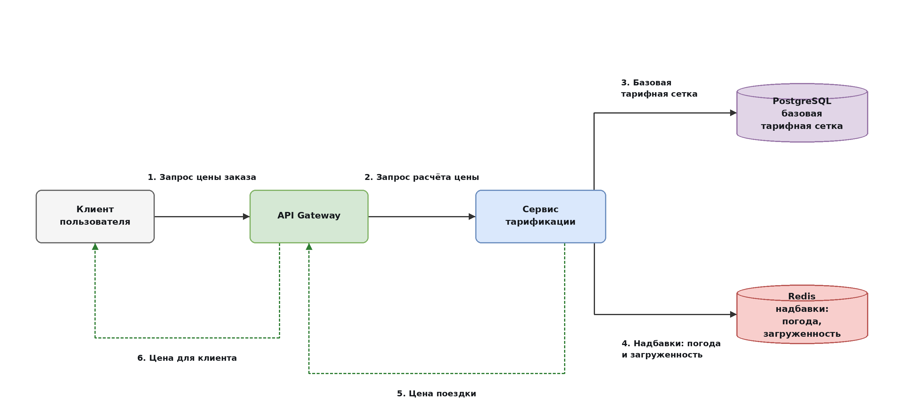
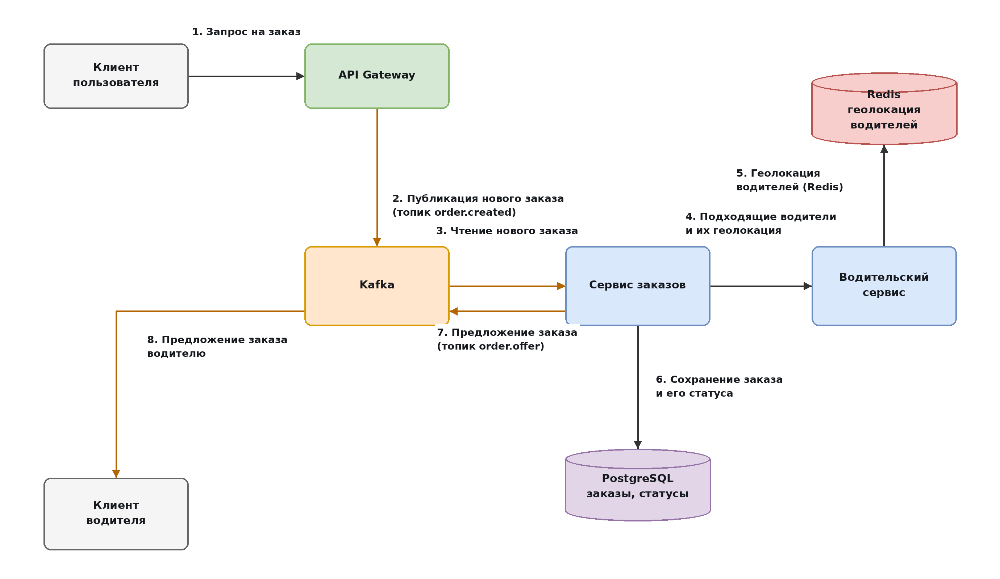
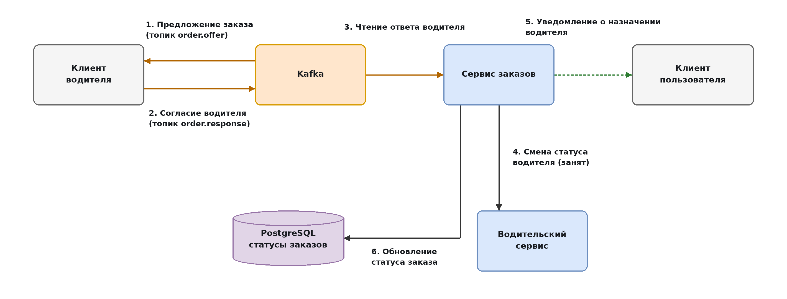

# ДЗ 1. Анализ референсной архитектуры — решение

> Условие: [../Задание.md](../Задание.md) · Чек-лист: [../Чеклист.md](../Чеклист.md)
> Схемы складывайте в [diagrams/](diagrams/).

## Сервис такси

Описание: Позволяет пешеходам оставлять заявки на заказ такси, а водителям быть перевозчиками по найму и выполнить заказы.

Основные пользователи: Водители работающие по найму как перевозчики. Пешеходы, желающие облегчить передвижение на такси.
Сценарии: 

1. Обработка заказов на вызов такси

2. Рассылка предложений на перевозку пассажиров водителям

3. Обновление статусов и локации водителей

4. Подсчет актуальной тарифицакии поездки засчет различных факторов

Масштаб:

1. 10-50тыс. активных заказов одновременно.

2. 100-500 тыс. желающих воспользоваться такси.

3. 100К-1М зарегистрированных водителей с разными статусами активности.

## 1. Компоненты

| Название компонента | Тип              | Ответственность                                                                                                                                                                                | Статус    |
|:--------------------|:-----------------|:-----------------------------------------------------------------------------------------------------------------------------------------------------------------------------------------------|:----------|
| API Gateway         | Gateway          | Маршрутизирует поступающие запросы от пользователей                                                                                                                                            | Stateless |
| Сервис тарификации  | Сервис           | Отдает текущую цену поездки в зависимости от тарифной сетки                                                                                                                                    | Stateless |
| Сервис заказов      | Сервис           | Получает запросы от пользователей на заказ такси, обновляет статусы заказа и назначает водителя, отправляя предложение нескольким водителям одновременно. Читает очередь с ответами водителей. | Stateless |
| Водительский сервис | Сервис           | Актуализирует местоположение водителей, обновляет их статус активности, содержит информацию о грейде водителя                                                                                  | Stateless |
| Kafka               | Брокер сообщений | В него поступают сообщения о принятии заказов от водителей. Партиционирование по id заказа.                                                                                                    | Stateful  |
| PostgreSQL          | БД               | Хранит историю заказов, статусы заказов, базовую тарифную сетку                                                                                                                                | Stateful  |
| Redis               | Кеш              | Хранит геолокацию водителей, дополнительную тарификацию в зависимости от погодных условий и загруженности.                                                                                     | Stateful  |

_Stateless — сервис не хранит состояние между запросами, поэтому любой его экземпляр обрабатывает любой запрос и реплики взаимозаменяемы. Stateful — компонент хранит данные, их нужно реплицировать, бэкапить и учитывать при отказе узла._

## 2. Потоки данных

### Сценарий 1. Расчёт цены поездки

Клиент запрашивает цену через API Gateway, и Gateway перенаправляет запрос в сервис тарификации. Сервис тарификации достает базовую тарифную сетку из PostgreSQL, добавляет к ней надбавки из Redis (погода и загруженность) и считает итоговую цену. Готовую цену клиент получает обратно через Gateway.

### Сценарий 2. Создание заказа и поиск водителей

Клиент отправляет запрос на заказ, а Gateway публикует заказ в Kafka. Из очереди сообщение читает сервис заказов, сохраняет заказ в PostgreSQL и запрашивает у водительского сервиса подходящих водителей вместе с их геолокацией. Водительский сервис берет геолокацию из Redis, сервис заказов выбирает двух ближайших водителей и отправляет им предложение через Kafka.

### Сценарий 3. Принятие заказа водителем

Клиент водителя читает из Kafka предложение заказа и показывает его водителю. Когда водитель принимает заказ, клиент водителя отправляет в Kafka сообщение о согласии. Сервис заказов читает это сообщение, обновляет статус заказа в PostgreSQL, меняет статус водителя через водительский сервис и уведомляет клиента пользователя о назначении водителя.

## 3. Проблемы и решения

_

| Название компонента | Решение проблемы                                                                                                                                                     |
|:------------------- |:-------------------------------------------------------------------------------------------------------------------------------------------------------------------- |
| API Gateway         | Единая точка доступа до сервиса такси извне                                                                                                                          |
| Сервис тарификации  | Отслеживает в реальном времени тарификацию в зависимости от условий на каждой улице/районе/городе, разделение ответственности.                                       |
| Сервис заказов      | Агрегирует в себе взаимодействие по заказам, разделение ответственности.                                                                                             |
| Водительский сервис | Оперативное обновление местоположения и статуса каждого водителя, разделение ответственности.                                                                        |
| Kafka               | Async и дедупликация - Решает вопрос гонки принятия заказов, дает возможность водителю ответить по мере возможности, а не оперативно отвлекаться находясь в движении |
| PostgreSQL          | Хранит информацию, которая не требует частого изменения, хранит историю завершившихся заказов                                                                        |
| Redis               | Хранит постоянноизменяющиеся данные, что снижает нагрузку на основную БД                                                                                             |

## 4. Вопросы к авторам архитектуры

1. Сколькими разновидностями БД обходятся при миллионных нагрузках.

2. Есть ли аукцион водителей при выборе водителей под заказ

3. Используется ли WebSocket соединения и в каких случаях
